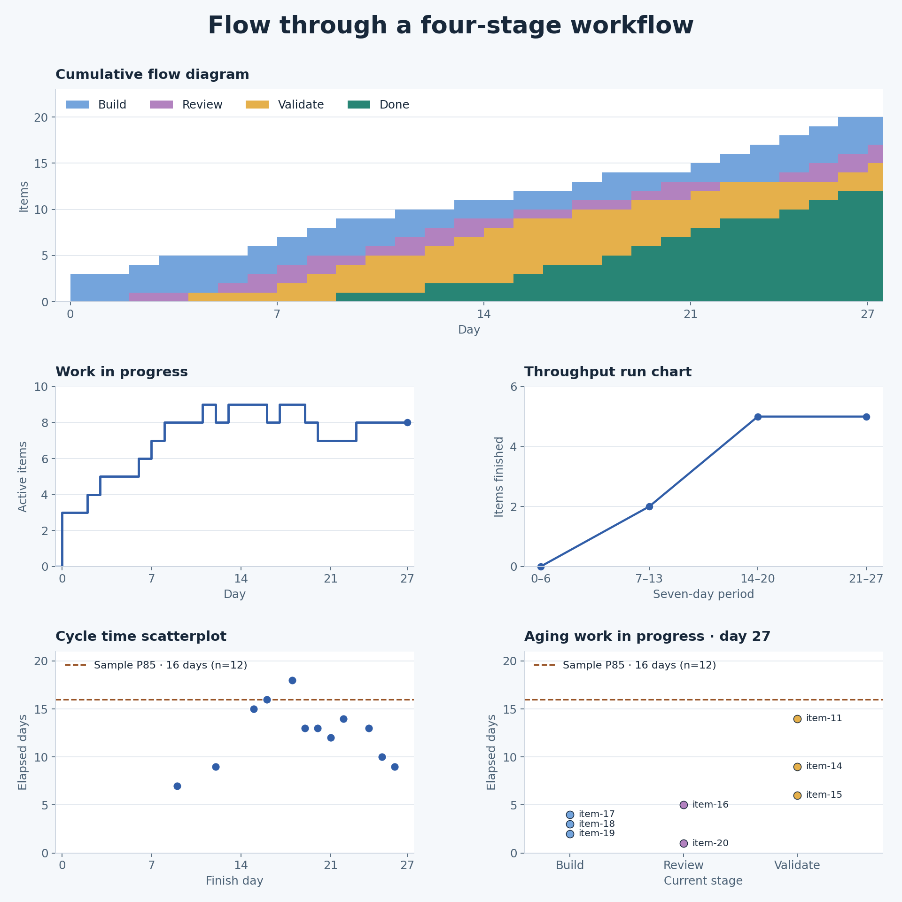

# A simple flow dataset

[Simple flow](simple-flow.json) is a 20-item synthetic example adapted from an existing balanced-flow fixture. It follows one kind of work through **Build → Review → Validate → Done**. Day 0 is the first build date. The sample uses whole calendar days and ends after day 27. Build is the start boundary, and Validate combines testing, release preparation, and follow-up before Done.

## Input contract for agents

Pass a JSON object with this shape to `createFlow`. If your source is a table or event feed, group events by item and convert the data before calling the library.

| Field | What to supply |
| --- | --- |
| `stages` | An ordered, nonempty array of unique, nonblank stage names. Keep them in workflow order for charting. |
| `terminalStages` | A nonempty subset of `stages` marking workflow exits. This example has one exit, Done. |
| `items` | An array of work items with unique, nonblank string IDs. Use one unit of work within the cohort. |
| `items[].transitions` | At least one `{ "at": number, "stage": "stage name" }` per item. Use a finite number and a declared stage. Sort by time and retain source order for ties. |

- **Start the clock at the agreed boundary.** The first supplied transition is the start. Keep pre-start backlog out of the histories, and include items that started earlier if they could still be active or finish in the reporting window. Supply the real start and relevant stage changes. A record with only a finish date would otherwise look like a zero-day completion.
- **Use one time unit.** The example uses day numbers. For real event logs, convert timezone-qualified timestamps to epoch milliseconds and use that unit for observations and window boundaries too. Convert output durations to the display unit once.
- **Keep unfinished histories.** An item whose latest transition is nonterminal is in WIP. Supply a finish transition only when observed. At a given `asOf`, the last transition at or before that time wins, including when several share the same timestamp.
- **Interpret exit outcomes explicitly.** The API counts all terminal outcomes as completions. If cancellation and delivery are different exits, define which events count before labeling a chart “Delivered.” A reopen returns the item to WIP, keeps the original start, and replaces its prior completion once it finishes again. See the [metrics guide](../docs/flow-metrics-guide.md) for snapshot semantics.

From the repository root, use Node.js 22 or later:

```js
import { readFileSync } from 'node:fs';
import { createFlow } from './index.mjs';

const dataset = JSON.parse(readFileSync('examples/simple-flow.json', 'utf8'));
const flow = createFlow(dataset);
const day27 = flow.snapshot(27, { throughputSince: 20 });
// counts: { Build: 3, Review: 2, Validate: 3, Done: 12 }
// wip: 8, throughput in (20, 27]: 5, oldestAge: 14
```

## Charts

`flow-metrics` supplies the numbers. The example scripts turn those numbers into five charts. `chart-data.mjs` emits JSON using the public API and needs only Node. The optional renderer needs Python and Matplotlib.

```sh
node examples/chart-data.mjs
node examples/chart-data.mjs | python3 examples/plot-charts.py
```

The second command regenerates [flow-charts.png](flow-charts.png). On Windows, use `python` if that is how Python is installed.



## Review against Yuval Yeret’s guidance

The WIP trend, cycle-time scatterplot, and throughput run chart use the recommended chart forms. The CFD works for the workflow we supplied. The aging chart shows the right data for a first pass and needs more context to guide intervention. [Flow Metrics for Scrum](https://yuvalyeret.com/blog/4-key-flow-metrics-and-how-to-use-them-in-scrums-events/)

| Chart | What it shows and where it falls short |
| --- | --- |
| Cumulative flow diagram | Daily stage counts are stacked with Done at the bottom. Band thickness shows inventory by stage. The Validate band combines several distinct queues and activities, so a wider band tells you where to investigate, without locating the delay inside that stage. [Explaining Cumulative Flow Diagrams](https://agilesparks.com/wp-content/uploads/2022/10/explaining-cumulative-flow-diagrams-cfd3688-120723104300-phpapp01.pdf) |
| WIP over time | Directly charts started-but-unfinished items. WIP peaks at 9 and ends at 8. The sample has no agreed WIP limit, so the chart supports a conversation about load and leaves policy compliance undetermined. |
| Throughput run chart | Counts 0, 2, 5, and 5 finishes in equal seven-day periods, including the zero period. The rise starts from an empty workflow, so it does not establish an improvement. It works for this one-way workflow. With reopens, window-end snapshots can miss or double-count finish events across periods. Decide whether to measure delivery events or current completions before using the series for planning. |
| Cycle time scatterplot | One point per currently finished item, with finish day on x and elapsed days on y. The 16-day P85 is descriptive. Twelve completed items from a cohort with eight still open are a weak basis for a service level expectation, especially early in the observation window when long-running work is still in flight. |
| Aging WIP | One point per open item, plotted by current stage and total age. `item-11` is 14 days old and has spent 5 days in Validate. The shared P85 line provides context, but time in stage and a credible expectation for remaining work would better distinguish which item needs attention today. [Detecting Flow Issues Using Predictive Cycle Time Charts](https://www.scrum.org/resources/blog/detecting-flow-issues-using-predictive-cycle-time-charts-origin-kanbanflow-work-item-aging-metric) |

**Two checks for production use.** An item that finishes on day 3, reopens on day 4, and finishes again on day 8 is absent from the day-7 completion snapshot. If the first window had closed on day 3, it could appear in both periods. Reopening can shrink the CFD’s Done band and remove an earlier point from the scatterplot. A later finish puts the point back at the new finish date. Separately, one delivery plus one cancellation counts as two completions and contributes two cycle times when both are terminal. These behaviors follow the library’s snapshot contract. Decide on a delivery-event policy before turning these readings into a historical delivery report.

For a live workflow, the first chart improvement is to show time in stage alongside total age and use a team-defined service level expectation (SLE). That lets people investigate why an item is waiting while they can still act on it. Keep enough workflow detail to distinguish waiting from active work. [Teach your AI agents to help you Focus on Flow](https://yuvalyeret.com/blog/why-focus-on-flow-metrics/) · [AI Coding Made Code Review the Bottleneck](https://yuvalyeret.com/blog/ai-coding-made-code-review-the-bottleneck/)
