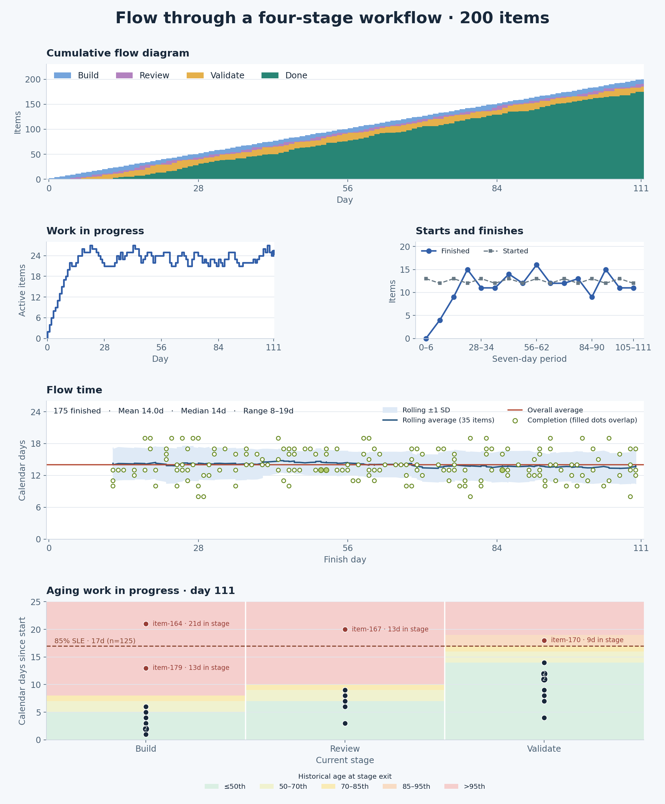

# A simple flow dataset

[Simple flow](simple-flow.json) is a 20-item synthetic example adapted from an existing balanced-flow fixture. It follows one kind of work through **Build → Review → Validate → Done**. Day 0 is the first build date. The sample uses whole calendar days and ends after day 27. Build is the start boundary, and Validate combines testing, release preparation, and follow-up before Done.

[SLE flow](sle-flow.json) uses the same schema and stages for **200 items**. It resamples stage-duration sequences from 47 completed histories in the synthetic balanced-flow fixture. The starts are spread across 112 days, and a few recent items have deliberately added delays so the chart exercises early warnings. The sample ends after day 111.

## Input contract for agents

Pass a JSON object with this shape to `createFlow`. If your source is a table or event feed, group events by item and convert the data before calling the library.

| Field | What to supply |
| --- | --- |
| `stages` | An ordered, nonempty array of unique, nonblank stage names. Keep them in workflow order for charting. |
| `terminalStages` | A nonempty subset of `stages` marking workflow exits. This example has one exit, Done. |
| `items` | An array of work items with unique, nonblank string IDs. Use one unit of work within the cohort. |
| `items[].transitions` | At least one `{ "at": number, "stage": "stage name" }` per item. Use a finite number and a declared stage. Sort by time and retain source order for ties. |

- **Start the clock at the agreed boundary.** The first supplied transition is the start. Keep pre-start backlog out of the histories, and include items that started earlier if they could still be active or finish in the reporting window. Supply the real start and relevant stage changes. A record with only a finish date would otherwise look like a zero-day completion.
- **Use one time unit.** The fixtures use calendar-day indices. The library returns elapsed differences. The example charts add one to cycle time, work item age, and time in stage to count the start date as day one. Stage day counts can share a transition date. For real event logs, convert timezone-qualified timestamps to epoch milliseconds and use that unit for observations and window boundaries too. Convert output durations to the display unit once.
- **Keep unfinished histories.** An item whose latest transition is nonterminal is in WIP. Supply a finish transition only when observed. At a given `asOf`, the last transition at or before that time wins, including when several share the same timestamp.
- **Interpret exit outcomes explicitly.** The API counts all terminal outcomes as completions. If cancellation and delivery are different exits, define which events count before labeling a chart “Delivered.” A reopen returns the item to WIP, keeps the original start, and replaces its prior completion once it finishes again. See the [metrics guide](../docs/flow-metrics-guide.md) for snapshot semantics.

From the repository root, use Node.js 22 or later:

```js
import { readFileSync } from 'node:fs';
import { createFlow } from './index.mjs';

const dataset = JSON.parse(readFileSync('examples/simple-flow.json', 'utf8'));
const flow = createFlow(dataset);
const day27 = flow.snapshot(27, { throughputSince: 20 });
// counts: { Build: 3, Review: 2, Validate: 3, Done: 12 }
// wip: 8, throughput in (20, 27]: 5, oldestAge: 14
```

## Charts

`flow-metrics` supplies the numbers. The example scripts turn those numbers into five charts. `chart-data.mjs` emits JSON using the public API and needs only Node. The optional renderer needs Python and Matplotlib.

```sh
node examples/chart-data.mjs
node examples/chart-data.mjs | python3 examples/plot-charts.py
node examples/chart-data.mjs sle | python3 examples/plot-charts.py examples/flow-charts-sle.png
```

The render commands produce [charts for 20 items](flow-charts.png) and [charts for 200 items](flow-charts-sle.png). On Windows, use `python` if that is how Python is installed.



### Read the SLE example

- **Freeze the baseline.** Use 125 comparable items finished on days 21–90, then assess the 25 open items on day 111. The nearest-rank 85th percentile sets the demonstration SLE at **17 inclusive calendar days**. The other 50 finished items fall outside the calibration window. The synthetic history demonstrates the method. A live SLE needs representative completions from the workflow being managed.
- **Compare age with stage.** Each dot represents open work at its current stage and total age. A numbered dot groups items with the same stage and age. The colored bands mark the historical ages at which 50%, 70%, 85%, and 95% of the baseline cohort had exited that stage. The dashed line marks the end-to-end SLE. [55 Degrees’ work item age guide](https://www.55degrees.se/blog/post/what-is-work-item-age) · [Aging chart documentation](https://55degrees.atlassian.net/wiki/spaces/AAS/pages/2454290433)
- **Inspect an item while it can still finish.** `item-179` is 13 days old in Build. That is below the 17-day SLE and above Build’s 8-day P85 exit age. Three other open items are already over the SLE. The flagged dots show time in the current stage so you can ask what each item is waiting for.
- **Read the flow-time trend.** Green dots mark completed items by finish day. Larger, filled dots show overlapping completions. The red line shows the overall mean. The blue line shows a centered rolling mean over 35 completions in the larger example and five in the smaller example. The shading spans one sample standard deviation on either side of the rolling mean. The window shortens near both ends.

## Review against Yuval Yeret’s guidance

The WIP trend, cycle-time scatterplot, and throughput run chart follow the recommended forms. The CFD represents the stages we supplied. In the larger example, stage-level pace bands make the aging chart useful before the end-to-end SLE is crossed. [Flow Metrics for Scrum](https://yuvalyeret.com/blog/4-key-flow-metrics-and-how-to-use-them-in-scrums-events/)

| Chart | What it shows and where it falls short |
| --- | --- |
| Cumulative flow diagram | Daily stage counts are stacked with Done at the bottom. Band thickness shows inventory by stage. The Validate band combines several distinct queues and activities, so a wider band tells you where to investigate, without locating the delay inside that stage. [Explaining Cumulative Flow Diagrams](https://agilesparks.com/wp-content/uploads/2022/10/explaining-cumulative-flow-diagrams-cfd3688-120723104300-phpapp01.pdf) |
| WIP over time | Directly charts started-but-unfinished items. The small example peaks at 9 active items and ends at 8. Add an agreed limit when the team wants to review its pull policy. |
| Throughput run chart | The small example counts 0, 2, 5, and 5 finishes in equal seven-day periods, including the zero period. The rise starts from an empty workflow, so it does not establish an improvement. The starts line shows when pull exceeds finishes. With reopens, window-end snapshots can miss or double-count finish events across periods. Decide whether to measure delivery events or current completions before using the series for planning. |
| Cycle time scatterplot | Plots each currently finished item by finish day and inclusive cycle days. The mean and rolling band describe the finished cohort. Long-running open items are visible in Aging WIP and contribute to the scatterplot after they finish. |
| Aging WIP | The 20-item example has only 12 completions and labels its 17-day threshold as sample P85. The 200-item example adds a separate calibration period, stage-exit pace bands, and time-in-stage labels for slow items. The bands describe observed pace and help prioritize inspection. [Detecting Flow Issues Using Predictive Cycle Time Charts](https://www.scrum.org/resources/blog/detecting-flow-issues-using-predictive-cycle-time-charts-origin-kanbanflow-work-item-aging-metric) |

**Two checks for production use.** An item that finishes on day 3, reopens on day 4, and finishes again on day 8 is absent from the day-7 completion snapshot. If the first window had closed on day 3, it could appear in both periods. Reopening can shrink the CFD’s Done band and remove an earlier point from the scatterplot. A later finish puts the point back at the new finish date. Separately, one delivery plus one cancellation counts as two completions and contributes two cycle times when both are terminal. These behaviors follow the library’s snapshot contract. Decide on a delivery-event policy before turning these readings into a historical delivery report.

### Which coaching metrics fit this dataset?

| Coaching metric | How it applies |
| --- | --- |
| Stage pace and time in stage | Use both for the daily review. Pace flags items unusually old for where they are. Time in stage shows how long the item has stayed there. |
| Starts versus finishes | Show both in equal periods to see when active inventory will grow. The CFD shows where it grows. |
| Approximate cycle time from the CFD | Use this when you have aggregate counts. Here we have item histories and can measure actual cycle times. |
| Flow efficiency, blocked time, and flow distribution | These need more input. Flow efficiency needs meaningful active/wait states or touch-time data. Blocked time needs blocked intervals. Distribution and per-class SLEs need work-class labels and enough completions per class. |
| Sprint carryover and predictability | These need a sprint calendar and membership history, including work added after the sprint starts. |
